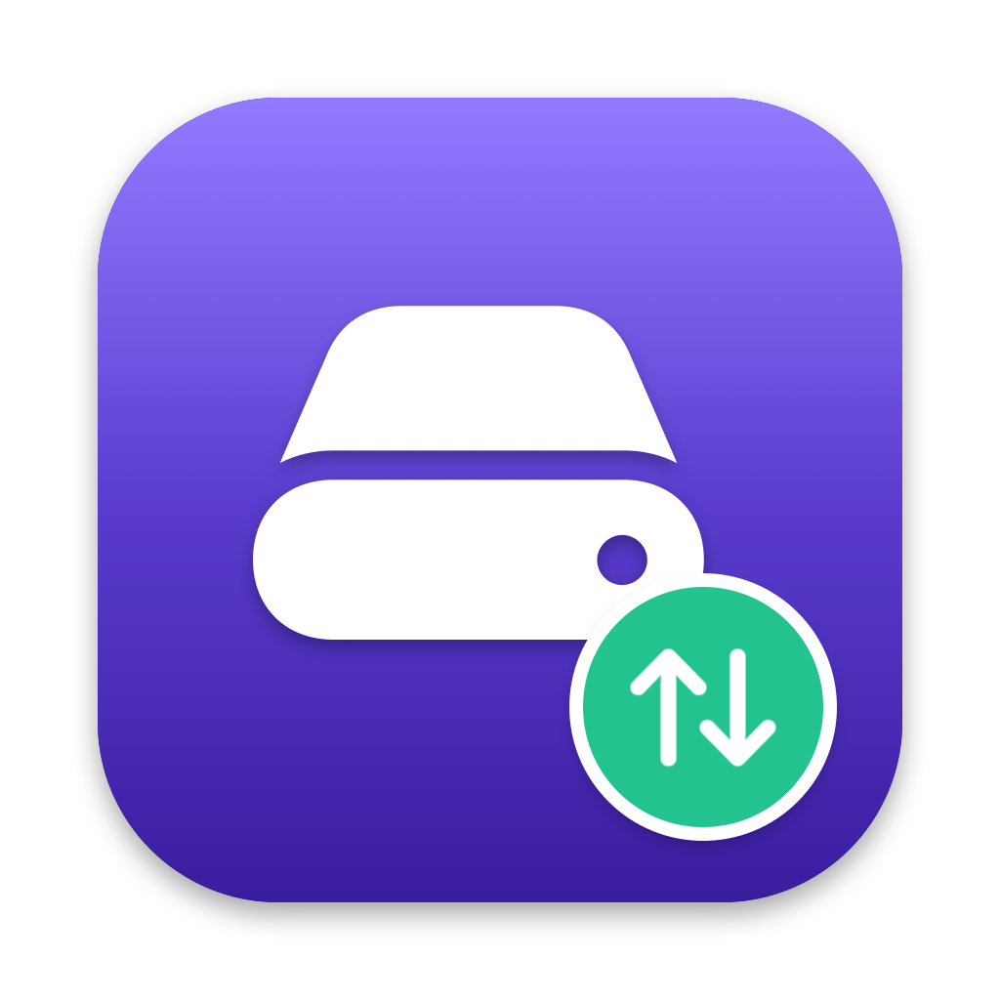

<p align="center"></p>

# AppVault

Free up space on your Mac by moving apps you don't need right now to a home server, then bring them back with one click when you do.

- **Mac app** (SwiftUI, macOS 14+): lists your apps by size, sends them to the server, restores them.
- **Server** (Go, Docker): stores the apps on a mounted share. Built for Unraid, runs on any Docker host.

## Features

- Move (upload, verify, then delete locally) or copy apps to the server. You choose each time.
- Restore puts the app back where it was. The server keeps its copy, so offloading the same unchanged app again is instant.
- Categories (Games, Tools, …) that you create, rename and delete. AppVault suggests one from the app's own metadata.
- Optional app data per app: include folders like `~/Library/Application Support/<app>` or `~/Library/Containers/<bundle id>` so saves and settings travel with it.
- Scans `/Applications`, `~/Applications`, and any extra folders you add (e.g. a game library). Plain folders work too, not only `.app` bundles.
- Pause and resume big transfers. Uploads resume even after quitting the app or restarting the server; dropped connections retry automatically.
- Every transfer is checked end to end with SHA-256. Apps keep their code signatures, permissions, symlinks and extended attributes.
- App icons are stored on the server, so offloaded apps still show their icon. Search and sort everywhere.

## How it stores things

The library lives on the share you mount at `/data`, never inside the container:

```
/mnt/user/appvault/
  Games/
    Some Game/
      app.tar      the app bundle (uncompressed tar)
      data.tar     optional app data
      icon.png
      meta.json    name, version, original path, checksums, ...
  Tools/
  Uncategorized/
  .staging/        unfinished uploads
```

Each category is a folder and each item is self-describing, so the library can be rebuilt from disk at any time. Apps are stored as tar archives because SMB/XFS shares can damage macOS code signatures and extended attributes if `.app` folders are stored raw.

## Server setup (Unraid)

1. Make a share for the library, e.g. `appvault`. Large games are a good fit for the array rather than the cache pool.
2. Generate a token: open the Unraid terminal and run `openssl rand -hex 24`. Keep it for step 4 and for the Mac app.
3. Install the template:
   ```sh
   wget -O /boot/config/plugins/dockerMan/templates-user/my-appvault.xml \
     https://raw.githubusercontent.com/Sausagerolls/AppVault/main/server/unraid/my-appvault.xml
   ```
4. In the Docker tab: **Add Container**, pick **appvault** from the template list, check the Storage path, paste the token into **API Token**, and click **Apply**.
5. From your Mac, check `http://<server>:8420/api/health` in a browser. It should return `{"ok":true,...}`.

The container runs as `nobody:users` (99:100), the Unraid default for share files.

### Other Docker hosts

```sh
docker run -d --name appvault --restart unless-stopped \
  -p 8420:8420 \
  -v /path/to/library:/data \
  -e APPVAULT_TOKEN="$(openssl rand -hex 24)" \
  --user 99:100 \
  ghcr.io/sausagerolls/appvault-server:latest
```

### Building the image yourself

```sh
git clone https://github.com/Sausagerolls/AppVault.git
cd AppVault/server
docker build -t appvault-server:latest .
```

Then set the template's Repository to `appvault-server:latest`.

### Configuration

| Variable          | Default | Meaning                                          |
|-------------------|---------|--------------------------------------------------|
| `APPVAULT_TOKEN`  | none    | Required. Shared secret, at least 16 characters. |
| `APPVAULT_DATA`   | `/data` | Library location inside the container.           |
| `APPVAULT_PORT`   | `8420`  | Listen port.                                     |

## Mac app setup

1. Download `AppVault-mac.zip` from the [latest release](https://github.com/Sausagerolls/AppVault/releases/latest), unzip it, and move `AppVault.app` to `/Applications`.
2. The app is not notarized, so macOS blocks it the first time. Either run
   ```sh
   xattr -dr com.apple.quarantine /Applications/AppVault.app
   ```
   or open it once, then go to **System Settings › Privacy & Security** and click **Open Anyway**.
3. Open **AppVault › Settings**, enter the server address (e.g. `http://tower.local:8420`) and the token, and click **Test Connection**.
4. Grant permissions under **System Settings › Privacy & Security**:
   - **App Management**: required to delete or replace other apps in `/Applications`.
   - **Full Disk Access**: only needed if you include app data from `~/Library/Containers`.

When you're away from home, use the server's Tailscale or WireGuard address. Traffic is plain HTTP authenticated by the token, so don't expose port 8420 to the internet directly.

The token is stored in your login Keychain. Because the app is ad-hoc signed, macOS may ask for your keychain password once after each update. Choose **Always Allow**.

### Building from source

Requires Xcode on macOS 14 or later.

```sh
cd mac
./build-app.sh            # builds dist/AppVault.app (universal)
./build-app.sh --install  # also copies it to /Applications
```

## Using it

- **This Mac**: every app and folder found, biggest first, with its server status. Double-click or use **Send to Server** to pick a category, choose any app data to include, then **Copy** or **Move**. Move deletes the local copy only after the server confirms the checksum.
- **Server**: the library by category. Double-click to restore. Right-click to change category or delete. Use **+** next to "Server" to add a category; right-click a category to rename or delete it.
- **Transfers**: progress, speed and time left, with pause, resume, cancel and retry.

Quit an app before sending or restoring it. Apps installed by a `.pkg` are often owned by root; AppVault asks for an administrator password to remove those.

## API

All endpoints except `/api/health` need `Authorization: Bearer <token>`.

| Method | Path | Purpose |
|---|---|---|
| GET | `/api/health` | Liveness check |
| GET | `/api/stats` | Disk and library usage |
| GET, POST | `/api/categories` | List or create categories |
| PATCH, DELETE | `/api/categories/{name}` | Rename, or delete an empty category |
| GET | `/api/items` | List the library |
| GET, PATCH, DELETE | `/api/items/{id}` | Get, change category/notes, delete |
| GET | `/api/items/{id}/icon` | Icon PNG |
| GET | `/api/items/{id}/parts/{app\|data}` | Download an archive (supports `Range`) |
| GET, POST | `/api/uploads` | List unfinished uploads, start one |
| GET, DELETE | `/api/uploads/{id}` | Upload status and offsets, abort |
| PATCH | `/api/uploads/{id}/parts/{app\|data}?offset=N` | Append bytes at offset N |
| PUT | `/api/uploads/{id}/icon` | Set the icon |
| POST | `/api/uploads/{id}/complete` | Verify checksums and add to the library |

## Known limitations

- Setuid bits are dropped on restore (macOS `tar` does not restore them for non-root users). Normal apps don't use them.
- ACLs and file flags are not stored.
- One transfer runs at a time; others queue.
- Restores that are interrupted by quitting the app start again from the beginning. Uploads continue where they stopped.
